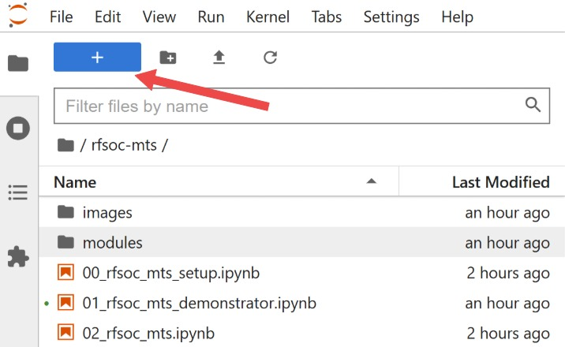
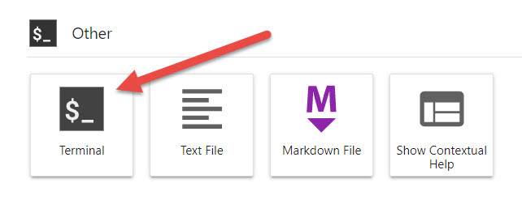

 
 
 <table border="0" align="center">
     <tr border="0">
         <td align="center" width="50%" border="0">
             
         </td>
         <td align="center" width="50%" border="0">
             <font size=7><b>Available Now!</b></font size> <br> <font size=5>Software Defined Radio with Zynq® UltraScale+ RFSoC</font size> <br> <font size=4><a href="https://rfsocbook.com/">Free Download</a> <br><a href="https://www.amazon.com/Software-Defined-Radio-Ultrascale-RFSoC/dp/1739588606?keywords=zynq+rfsoc&qid=1673452844&sprefix=%2Caps%2C137&sr=8-1&linkCode=ll1&tag=thzybo-20&linkId=0bf245a543fd4af4625086df4c190928&language=en_US&ref_=as_li_ss_tl">Printed Edition</a></font size>
         </td>
     </tr>
 </table>
 
 # Multi-Tile Sychronisation support for PYNQ w/ Digital Feature Synch.
 This repository has been tested with [PYNQ image v3.1.1](https://github.com/Xilinx/PYNQ/releases) (Vivado 2024.2) for the following RFSoC development boards. Newer PYNQ versions may require different Vivado versions; please verify compatibility against the PYNQ release notes:

 [* ZCU208(https://www.xilinx.com/products/boards-and-kits/zcu208.html),]: # 
 * [RFSoC4x2](http://rfsoc-pynq.io/),
 * [ZCU208](https://www.xilinx.com/products/boards-and-kits/zcu208.html),
 
 <p align="center">
   
 </p>
 
 ## Quick Start
 Follow the instructions below to install the Multi-Tile Synchronisation (MTS) Demonstrator now. <b>You will need to give your board access to the internet</b>.
 *  Power on your RFSoC development board with an SD Card containing a fresh PYNQ v3.0.1 image or greater.
 *  Navigate to Jupyter Labs by opening a browser (preferably Chrome) and connecting to `http://<board_ip_address>:9090/lab`.
 * We need to open a terminal in Jupyter Lab. Firstly, open a launcher window as shown in the figure below:
 
 <p align="center">
   
 </p>
 
 * Now open a terminal in Jupyter as illustrated below:
 
 <p align="center">
   
 </p>
 
 Run the code below in the jupyter terminal to install the Spectrum Analyser.
 <div class="alert alert-box alert-danger">
<b>Caution:</b>
    The commands below will alter the <i>xrfdc</i> package included with PYNQ. If you have made changes to this package, you should save them before installing this repository.
</div>

 ```sh
 pip3 install git+https://github.com/strath-sdr/rfsoc-mts
 cd /rfsoc-mts
 bash install.sh
 ```
 
 Once installation has complete you will find the Multi-Tile Synchronisation notebooks in the Jupyter workspace directory. The folder will be named 'rfsoc-mts'.

 ### For internal use
 While this repository is not publicly available, you won't be able to ```pip3 install``` the sitory. Therefore, you will need to download the repository as a zip and drag-and-drop it into the Jupyter Labs workspace directory. After doing so open the terminal and run the following commands
 ```sh
 mv /home/xilinx/jupyter_notebooks/rfsoc-mts-main.zip /
 unzip rfsoc-mts-main.zip
 cd /rfsoc-mts-main
 bash install.sh
 ```
 
 ## Using the Project Files
 The following software is required to use the project files in this repository.
 - Vivado Design Suite 2024.2
 
 ### Vivado
 This project can be built with Vivado from the command line. Open Vivado 2024.2 and execute the following into the tcl console:
 ```sh
 cd /<repository-location>/boards/<board-name>/rfsoc_mts/
 ```
 Now that we have moved into the correct directory, make the Vivado project by running the make commands below sequentially.
 ```sh
 make block_design
 make bitstream
 ```
 
 Alternatively, you can run the entire project build by executing the following into the tcl console:
 ```sh
 make all
 ```
 
 ## License 
 [BSD 3-Clause](../../blob/master/LICENSE)
 